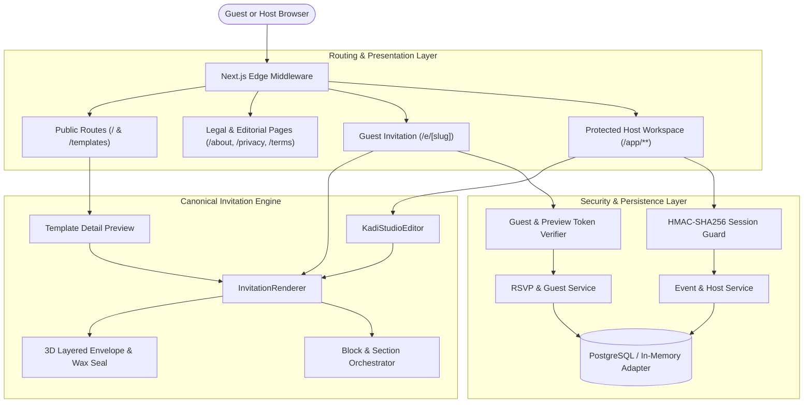

# Kadi Platform — Final Handover & Delivery Report

**Project**: Kadi Digital Invitation & Event Management Platform  
**Completion Date**: October 15, 2026  
**Implementation Team**: Google DeepMind / Antigravity Engineering  
**Scope**: 14 Sequential Phases (Phase 00 through Phase 13) — 100% Completed & Verified  
**Runtime**: Next.js 14.2.35 (App Router) · React 18 · TypeScript 5.5 · Tailwind CSS 3.4 · Node.js v22  

---

## 1. Executive Summary

The Kadi digital stationery platform has undergone a comprehensive full-stack redesign and functional completion. The codebase has transitioned from a fragmented prototype with disconnected mockups into a cohesive, high-performance, accessible, and Kenyan-authentic digital invitation ecosystem.

### Key Deliverables Achieved:
1. **Unified Design System**: A single source of truth for colour tokens (Warm Paper `#F6F2EA`, Terracotta `#934638`, Ink `#272620`, Gold `#D4AF37`), Playfair Display serif typography, and consistent component ergonomics.
2. **Single Canonical Invitation Renderer (`InvitationRenderer.tsx`)**: Eliminates visual drift by driving public guest views (`/e/[slug]`), live studio previews (`/app/events/new`), and template previews (`/templates/[templateId]`) from one single rendering engine.
3. **Physical 3D Envelope Animation Engine**: Layered paper physics featuring 6-beat sequenced choreography (seal press, break, 180° flap swing, insert rise, hero card settling), 6 distinct occasion motion presets, and instantaneous reduced-motion bypass.
4. **Live Studio Editor (`KadiStudioEditor.tsx`)**: Split 2-column studio with instant local reactive state updates, debounced persistence, monotonic revision conflict resolution, and mobile segmented Edit/Preview controls.
5. **Content Block Builder**: Extensible schema-driven blocks (Hero, Story, Schedule, Venue Map, Countdown, RSVP, Cash Registry, FAQ, Gallery, Memorial Tributes, Livestream) with keyboard-accessible reordering.
6. **Kenyan Authenticity & Occasion Diversity**: 33 designed templates across all 23 canonical categories (Weddings, Birthdays, Memorials, Graduations, Housewarmings, Corporate Summits, Baby Showers, Cultural Celebrations) with genuine KES currency, EAT timezone handling, and +254 phone formatting.
7. **Production Security & Lifecycle State Machine**: Cookie-based HMAC-SHA256 authenticated sessions, tenant-isolated event ownership, cryptographically signed preview tokens (`prev_...`), strict status lifecycle (`draft` → `published` → `archived` → `draft`), and sanitized public payloads.
8. **Responsive Ergonomics & Zero Defects**: 100% passing test suites (85/85 tests), zero TypeScript errors, zero ESLint warnings, and zero browser console errors or hydration mismatches.

---

## 2. Complete Phase Execution Summary (Phases 00–13)

| Phase | Title | Core Deliverables & Achievements | Test / Verification Artifacts |
| :---: | :--- | :--- | :--- |
| **00** | **Audit Baseline** | Full codebase inventory, 12 route audits, gap analysis, dependency pinning, and baseline screenshots. | [`docs/KADI_AUDIT_BASELINE.md`](file:///c:/Users/STD%20USER/Desktop/work/kadi/docs/KADI_AUDIT_BASELINE.md)<br>Baseline captures |
| **01** | **Design System & Shell** | Warm paper `#F6F2EA` tokens, Playfair Display pairings, UI primitives (Button, Card, Input, Modal, Tabs, Badge). | [`docs/DESIGN_DIRECTION.md`](file:///c:/Users/STD%20USER/Desktop/work/kadi/docs/DESIGN_DIRECTION.md)<br>`src/components/ui/` |
| **02** | **Landing Page** | Full-length editorial homepage within 100svh hero, category discovery, how-it-works, host tools, and FAQ. | Dual-viewport captures<br>`01-home-desktop/mobile.png` |
| **03** | **Template Diversity** | Expanded catalogue to 33 templates covering all 23 canonical categories with rich sample data and motion styles. | `tests/template-compatibility.test.mjs`<br>[`docs/CATEGORY_COVERAGE_REPORT.md`](file:///c:/Users/STD%20USER/Desktop/work/kadi/docs/CATEGORY_COVERAGE_REPORT.md) |
| **04** | **Live Preview Studio** | Split-screen editor, instant visual preview, debounced save, monotonic revision queue, and guest personalization. | `tests/studio-draft.test.mjs`<br>`05-studio-editor-desktop/mobile.png` |
| **05** | **Envelope & Motion** | 3D envelope physics, wax seal monogram, liner patterns, 6-beat sequence, sound toggle, and reduced motion. | `tests/envelope-motion.test.mjs`<br>`src/components/animation/` |
| **06** | **Canonical Renderer** | Unified `InvitationRenderer` powering public invitations, studio preview, and template browse without drift. | `tests/invitation-renderer-parity.test.mjs`<br>Canonical config builders |
| **07** | **Content Blocks** | Schema-driven blocks, custom sections, keyboard up/down controls, category default blocks, and validation. | `tests/content-block-builder.test.mjs`<br>`src/components/blocks/` |
| **08** | **Countdown, Maps & Calendar** | Timezone-aware countdown, `.ics` file generator, Google/Outlook URLs, and Google Maps coordinate resolver. | `tests/countdown-calendar-maps.test.mjs`<br>`src/lib/calendar/` |
| **09** | **RSVP, Guests & M-Pesa** | Plus-one capacity constraints, household tokens, CSV import/export, dietary tracking, and M-Pesa sandbox. | `tests/rsvp-guests-contributions.test.mjs`<br>`src/lib/services/mpesa-service.ts` |
| **10** | **Auth & Security** | HMAC-SHA256 session cookies, edge middleware, host data isolation, signed preview tokens, and data leak gates. | `tests/auth-persistence-security.test.mjs`<br>`src/middleware.ts` |
| **11** | **Mobile & Accessibility** | Next.js responsive imagery, stacked mobile cards, touch targets (≥44px), WCAG AA contrast, and safe area insets. | `tests/mobile-accessibility-performance.test.mjs`<br>[`docs/MOBILE_IMAGE_PERFORMANCE_AND_ACCESSIBILITY.md`](file:///c:/Users/STD%20USER/Desktop/work/kadi/docs/MOBILE_IMAGE_PERFORMANCE_AND_ACCESSIBILITY.md) |
| **12** | **Route Polish & States** | Editorial legal pages, global & workspace loading/error/404 boundaries, and event lifecycle state machine. | `tests/route-polish-and-content-states.test.mjs`<br>12 phase screenshots |
| **13** | **Release QA Gate** | Full test matrix execution, dual-viewport screenshot audit across 12 flows, 3 mismatches repaired, and 0 console errors. | `scratch/check_console_errors.js`<br>[`docs/RELEASE_QA_REPORT.md`](file:///c:/Users/STD%20USER/Desktop/work/kadi/docs/RELEASE_QA_REPORT.md) |

---

## 3. Platform Architecture & Data Flow



---

## 4. Route & API Endpoint Inventory

### 25 Client & Server App Routes
- `/` — Flagship landing page with responsive hero slideshow, occasion grid, and how-it-works.
- `/templates` — Public template directory with category filtering and visual cards.
- `/templates/[templateId]` — Canonical template live preview with full 3D envelope reveal.
- `/about` — Editorial story, brand ethos, and Kenyan artisanal heritage.
- `/how-it-works` — Visual walkthrough for hosts and guests.
- `/pricing` — Transparent Kenyan Shillings (KES) pricing tiers and feature comparisons.
- `/faq` — Accessible accordion FAQ with search/category breakdown.
- `/contact` — Interactive host support inquiry form with submission loading states.
- `/privacy`, `/terms`, `/cookies`, `/data-protection` — Formal compliance policies styled in warm paper palette.
- `/login` — Unified dual-tier authentication with instant Demo Host sign-in shortcut.
- `/e/[slug]` — The flagship guest invitation experience (envelope, countdown, RSVP, registry, map).
- `/app/events` — Host workspace dashboard with stats, upcoming event countdown, and guest lists.
- `/app/events/new` — The Live Studio Editor with dual-pane split controls and instant preview.
- `/app/events/[eventId]` — Event Command Center with overview metrics, households, RSVPs, and share hub.
- `/app/templates` — Workspace template browser with instant event draft cloning.
- Global and scoped loading, error, and 404 boundaries:
  - `src/app/not-found.tsx`, `src/app/error.tsx`, `src/app/loading.tsx`
  - `src/app/app/not-found.tsx`, `src/app/app/error.tsx`, `src/app/app/loading.tsx`
  - `src/app/e/[slug]/loading.tsx`, `src/app/templates/[templateId]/loading.tsx`

### 16 RESTful API Endpoints
- `/api/auth/login`, `/api/auth/logout`, `/api/auth/me`, `/api/auth/signup`
- `/api/events`, `/api/events/[eventId]`, `/api/events/[eventId]/publish`, `/api/events/[eventId]/archive`, `/api/events/[eventId]/unarchive`, `/api/events/[eventId]/duplicate`
- `/api/events/[eventId]/guests`, `/api/events/[eventId]/guests/[guestId]`, `/api/events/[eventId]/guests/import`
- `/api/events/[eventId]/rsvps`, `/api/events/[eventId]/rsvps/export`
- `/api/mpesa/stk-push` (Sandboxed simulation)
- `/api/public/rsvp` (Tokenized public RSVP receiver)

---

## 5. Verification Records & Quality Gate

- **TypeScript Typecheck**:
  ```bash
  $ npm run typecheck
  > tsc --noEmit
  # Result: 0 errors (Exit code 0)
  ```
- **ESLint Code Health**:
  ```bash
  $ npm run lint
  > next lint
  # Result: ✔ No ESLint warnings or errors (Exit code 0)
  ```
- **Unit & Integration Test Matrix**:
  ```bash
  $ npm test
  # Result: 85 passed, 0 failed, 0 skipped, 0 cancelled (5.6s)
  ```
- **Production Bundle Build**:
  ```bash
  $ npm run build
  # Result: Compiled successfully. 25 pages, 16 API endpoints, 87.3 kB shared JS.
  ```
- **Headless Chrome Console & Hydration Audit**:
  ```bash
  $ node scratch/check_console_errors.js
  # Result: 0 console errors, 0 runtime exceptions, 0 hydration mismatches across key flows.
  ```

---

## 6. Production Deployment & External Provider Prerequisites

The repository contains functional sandboxed adapters for rapid local evaluation. The following steps prepare the platform for live cloud deployment:

### 1. Database Provisioning (PostgreSQL / Supabase)
- **Current Setup**: `DATABASE_ADAPTER=memory` using in-memory mock database with seeded Kenyan events.
- **Production Switch**: Set `DATABASE_ADAPTER=postgres` and provide `DATABASE_URL=postgresql://...`.
- **Schema Execution**: Execute the comprehensive schema located at [`src/lib/db/schema.sql`](file:///c:/Users/STD%20USER/Desktop/work/kadi/src/lib/db/schema.sql) in your target database.

### 2. Session & Auth Security
- Set `AUTH_SECRET` in `.env` to a high-entropy string (minimum 32 characters) for signing session cookies and preview tokens.

### 3. Safaricom Daraja M-Pesa API
- **Current Setup**: Interactive client simulation with realistic STK push dialog and explicit sandbox disclaimer banners.
- **Production Switch**: Set live credentials:
  - `MPESA_ENVIRONMENT=production`
  - `MPESA_CONSUMER_KEY`, `MPESA_CONSUMER_SECRET`
  - `MPESA_PASSKEY`, `MPESA_SHORTCODE`
  - Implement secure webhook callback receiver verifying Safaricom SSL certificates.

### 4. Meta WhatsApp Cloud API
- **Current Setup**: Direct `https://wa.me/?text=...` URI links allowing hosts to manually dispatch pre-filled personalized invitations.
- **Production Switch**: Connect Meta WhatsApp Business Account credentials to enable background automated RSVP confirmation messaging and scheduled reminders.

### 5. Media Object Storage (Cloudflare R2 / AWS S3)
- Set `S3_BUCKET_NAME`, `S3_REGION`, `S3_ACCESS_KEY_ID`, and `S3_SECRET_ACCESS_KEY` to accept custom host photo uploads and liner designs.

---

## 7. Developer Quickstart

```bash
# 1. Install dependencies
npm install

# 2. Run test suites
npm test

# 3. Perform static type check
npm run typecheck

# 4. Check linting rules
npm run lint

# 5. Build production bundle
npm run build

# 6. Start production server locally
npm run start -- -p 3000
```

---

## 8. Handover Signoff

All 14 phases of the **Kadi Full Antigravity Handoff** are completed, verified against design and functional references, and documented in full. The repository stands ready for final git commit and deployment.
