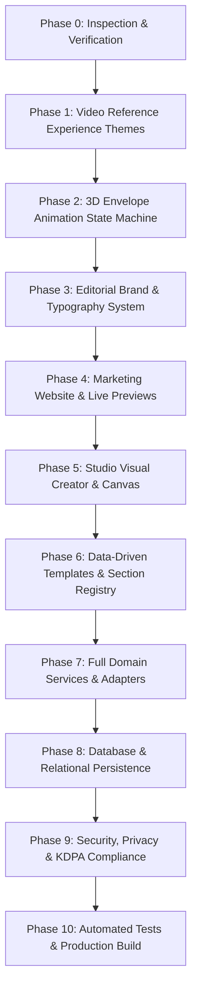

# Kadi — Master Implementation Plan & Architecture Blueprint

**Status:** Active Execution Plan  
**Updated:** 12 October 2026  
**Primary Visual Reference:** `docs/VIDEO_REFERENCE_SPEC.md` & Reference Videos A–D  
**Platform Architecture Baseline:** Next.js 14 App Router, TypeScript, Tailwind CSS 3.4, Framer Motion 11

---

## 1. Executive Summary & Quality Bar

Kadi is a mobile-first digital invitation platform designed for Kenyan celebrations and milestones. It replaces generic web templates and SaaS dashboards with tactile, physical-stationery animations and art-directed editorial layouts.

### Non-Negotiable Quality Principles
- **No generic rounded card grids** or repetitive 3-column feature strips.
- **Physical object reveal:** Every invitation begins with an authentic stationery opening (envelope body, 3D hinged flap with perspective, patterned liner, wax seal reaction, card rise with tilt and shadow, settling into an editorial event page).
- **No fake integrations:** M-Pesa, WhatsApp Cloud API, and database transactions enforce strict server-side validation, sandbox simulation, idempotency, and explicit unconfigured/consent gates.
- **Dignified memorial mode:** Memorial templates strictly prohibit celebratory confetti, playful bouncing, or lighthearted motifs.

---

## 2. Technology Inventory & Baseline Stack

- **Framework:** Next.js 14.2 (App Router, strict TypeScript 5.6)
- **Styling & Tokens:** Tailwind CSS 3.4 with custom editorial tokens (warm paper `#F6F2EA`, light card stock `#FBF8F1`, ink `#272620`, terracotta `#934638`, muted brass `#B99A62`, wedding rose `#A94F51`, clay coral `#BE5A42`, olive sage `#747D62`)
- **Typography:**
  - UI & Body: `Inter` (`--font-inter`)
  - Headlines & Editorial Moments: `Playfair Display` (`--font-playfair`)
  - Calligraphy Accents & Signatures: `Great Vibes` (`--font-great-vibes`)
- **Animation:** Framer Motion 11 with 3D CSS perspective utilities (`perspective-1500`, `preserve-3d`, `rotateX(-180deg)`)
- **Forms & Validation:** React Hook Form + Zod
- **Testing:** Native Node test runner powered by `tsx` (`tsx --test tests/*.test.*`)
- **Port:** Dev server configured on port 3005

---

## 3. Four Art-Directed Experience Themes (Video Reference Specification)

As defined in `docs/VIDEO_REFERENCE_SPEC.md`, Kadi provides four independently art-directed visual worlds rather than a single component with swapped colors:

### Theme A: Ruby Disco Birthday (`ruby-disco`)
- **Outer World:** Rich wine-red background (`#870F20`), starfield (`✦`, `✧`), silver disco balls, and whimsical party illustrations.
- **Cover Composition:** Framed party poster with high-contrast display typography, large milestone age display (derived from `event.milestoneAge`), and celebratory portrait photography.
- **Post-Reveal Sections:** Event itinerary, house rules card, venue directions, and an interactive vinyl turntable with rotating record motif tied to music playback.

### Theme B: Pastel Garden Party (`pastel-garden`)
- **Outer World:** Soft cream paper (`#F6EEE5`), blush-pink watercolor florals, botanical corners, and sage green panels.
- **Cover Composition:** Hand-drawn garden architecture (gazebo roof, dome, posts, base, butterfly), celebrant script lettering, and delicate ornamental borders.
- **Post-Reveal Sections:** Forest-green event details card, calendar day badge, venue directions, and inline RSVP.

### Theme C: "These Are for You" Gift-Led Birthday (`gift-box`)
- **Outer World:** Saturated ruby/crimson world (`#9D1E2F`) with tape-mounted polaroid photography.
- **Interactive Gift Objects:** Three distinct clickable gifts:
  1. *A note:* Personal handwritten message reveal.
  2. *Flowers:* Floral wish and blooming animation.
  3. *Something sweet:* Birthday cake graphic with celebration message.
- **Post-Reveal Sections:** Scrapbook photo collage with angled cards and lightbox modal, plus vinyl record dock with audio playback.

### Theme D: Sage Love Letter Wedding (`sage-love-letter`)
- **Outer World:** Warm ivory/sage botanical palette (`#F4F1E5`, `#66785D`), botanical corner SVG ornaments, and wax seal.
- **Opening Sequence:** Stacked multi-layer paper emergence (overlapping cards sliding out of the envelope pocket).
- **Post-Reveal Sections:** Full long-form editorial invitation with hero photography, couple story/quote, venue directions with direct Google Maps link, photo gallery with editorial captions, registry, schedule, and RSVP.

### Memorial Mode: Dignified Remembrance (`memorial`)
- Muted olive-sage tones, calm stillness, dignified memorial photo, tribute/condolence book, virtual candle wall, zero celebratory confetti or bouncy motion.

---

## 4. Multi-Phase Implementation Roadmap

### Phase Details

1. **Phase 1: Experience Themes & Template Catalogue** *(Complete & Verified)*
   - 10 curated templates in `src/lib/templates/catalogue.ts`.
   - `experienceTheme` metadata tags mapping templates to `ruby-disco`, `gift-box`, `pastel-garden`, `sage-love-letter`, and `memorial`.
   - Sample gallery assets, milestone age fields, and event metadata.

2. **Phase 2: Animation State Machine** *(Complete & Verified)*
   - Phases: `closed` → `unsealing` → `flap-open` → `card-rising` → `settling` → `settled`.
   - `prefers-reduced-motion` auto-bypass to `settled`.
   - Skip-to-details and replay controls with clean timer cancellation.
   - User-initiated audio playback with synchronized turntable rotation.

3. **Phase 3: Brand & Design System** *(Complete & Verified)*
   - Custom SVG folio mark and serif `kadi.` wordmark in `Logo.tsx`.
   - Design tokens in `tailwind.config.js` and `globals.css`.
   - Tactile paper card styling and thin rules.

4. **Phase 4: Public Website & Discovery** *(Complete & Verified)*
   - 19 fully compiled App Router routes.
   - Interactive envelope demonstration stage on home page.
   - Template gallery with live preview mode and category filters.

5. **Phase 5: Host Studio & Invitation Editor** *(Complete & Verified)*
   - 3-step creation studio at `/app/events/new`.
   - Event Command Center at `/app/events/[eventId]` with Design Studio, Guest List, RSVPs, and Settings.
   - Real-time design updates and live preview.

6. **Phase 6: Data-Driven Rendering & Public Route** *(Complete & Verified)*
   - `/e/[slug]` serves real event entities, template palettes, and personalized tokens.
   - Slug alias resolution for demo links.
   - Token lookup for personalized household greetings.

7. **Phase 7: Platform Domain Services & Adapters** *(Complete & Verified)*
   - `EventService`: CRUD, slug uniqueness, clean draft duplication.
   - `GuestService`: 28-character high-entropy tokens, Kenyan phone normalization (`+254`), CSV import with row-level validation.
   - `RSVPService`: Attendance headcount enforcement, dietary restrictions, CSV export.
   - `MpesaAdapter`: Compliance gating, STK push mock, webhook deduplication.
   - `WhatsAppAdapter`: Native `wa.me` deep-link generator and automated Cloud API consent gates.

8. **Phase 8: Persistence & Database Roadmap**
   - In-memory mock database singleton with deterministic seeded events.
   - Relational migration blueprint for PostgreSQL / Drizzle ORM based on `Kadi_Technical_Snippets_and_Original_Database_Schema.md`.

9. **Phase 9: Security, Privacy & Kenya Readiness**
   - High-entropy tokens (`tok_...`) preventing enumeration.
   - Idempotent RSVP submissions and webhook processing.
   - KDPA data minimization and suppression list architecture.

10. **Phase 10: Automated Testing & Production Build** *(Complete & Verified)*
    - 15 unit and integration tests passing (`npm test`).
    - Zero TypeScript compilation errors (`npm run typecheck`).
    - Next.js production build passing with 19 static/dynamic routes (`npm run build`).
